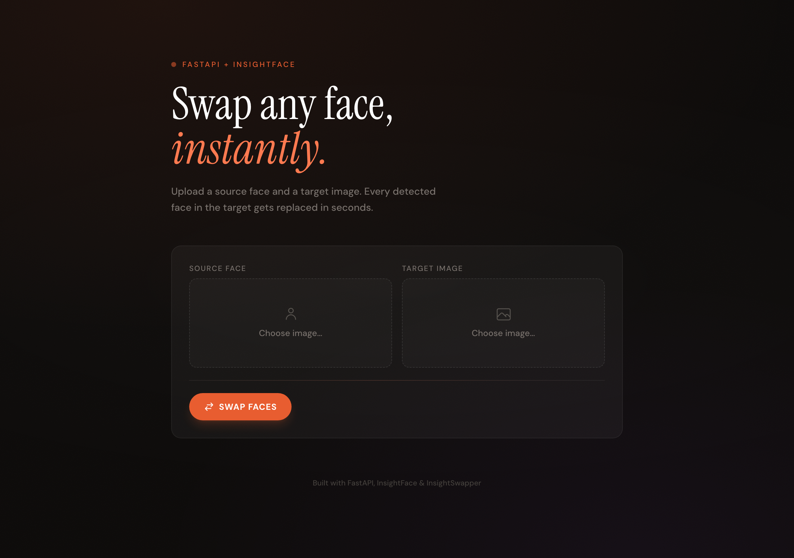

# Face Swap Web App

FastAPI web app for creating face-swapped images with `insightface` and the `inswapper_128.onnx` model.

## Screenshot



## Stack

- `FastAPI` for the web server and upload endpoints
- `Jinja2` for server-rendered HTML
- `insightface` for face analysis and face swapping
- `opencv-python` and `numpy` for image decoding and encoding
- `onnxruntime` for running the pretrained model

## What The App Does

1. Upload a source face image.
2. Upload a target image.
3. Detect the first face in the source image.
4. Detect all faces in the target image.
5. Replace each target face with the source face.
6. Save the generated image and show it in the browser.

## Project Structure

- [`app.py`](/Users/caique.silva/Code/Personal/face-swap/app.py) FastAPI app and face swap service
- [`templates/index.html`](/Users/caique.silva/Code/Personal/face-swap/templates/index.html) upload form and result page
- [`pyproject.toml`](/Users/caique.silva/Code/Personal/face-swap/pyproject.toml) Python dependencies
- [`model_store.py`](model_store.py) pinned model manifest and explicit setup command
- `models/` verified analysis bundle and swapper (not tracked in git)

## Setup

Install dependencies:

```bash
uv sync
```

Provision and verify the models before starting the app:

```bash
uv run python model_store.py setup
uv run python model_store.py verify
```

`FACE_SWAP_MODEL_DIR` changes the model directory for both setup and runtime;
the default is `models/` beside `app.py`. The expected layout is:

```
models/
  buffalo_l/
    1k3d68.onnx
    2d106det.onnx
    det_10g.onnx
    genderage.onnx
    w600k_r50.onnx
  inswapper_128.onnx
```

The trusted manifest in `model_store.py` pins SHA-256 and byte size for every
file. Its sources are the [official InsightFace model-zoo release](https://github.com/deepinsight/insightface/releases/tag/model-zoo):
`buffalo_l.zip` (SHA-256 `80ffe37d8a5940d59a7384c201a2a38d4741f2f3c51eef46ebb28218a7b0ca2f`)
and `inswapper_128.onnx` (SHA-256 `e4a3f08c753cb72d04e10aa0f7dbe3deebbf39567d4ead6dce08e98aa49e16af`).
The five analysis file hashes were derived from the verified archive. Setup
stages downloads in the target directory, validates them before publication,
and leaves already valid files untouched. A failed or interrupted setup can be
rerun. Runtime only reads and verifies these files; it never downloads or
deletes them. A missing or corrupt file stops startup with its path and the
setup command.

To use Docker Compose, run setup on the host first, then `docker compose up --build`.
Compose mounts the complete `models/` directory read-only. Ensure the host
`static/generated/` directory is writable by container UID/GID `10001`.

For Fly, create and provision a volume in the app's region before deploying
the web Machine. Use the image built from this repository and repeat setup for
each volume that will serve a Machine:

```bash
fly volumes create face_swap_models --size 2 --region gru -a face-swap
fly volumes list -a face-swap
fly machine run . --shell --user root --volume <volume-id>:/app/models --region gru -a face-swap
# In that temporary Machine's shell:
chown 10001:10001 /app/models
su -s /bin/sh app -c 'python /app/model_store.py setup'
su -s /bin/sh app -c 'python /app/model_store.py verify'
exit
fly deploy --ha=false -a face-swap
```

The temporary setup Machine is removed when its shell exits; the volume stays
for the web Machine. Fly's release commands do not mount app volumes, so they
cannot provision these models. The volume needs read/traverse access for UID
`10001`; only `static/generated/` needs runtime write access. For more web
Machines, create and provision another volume for each one.

## Run

```bash
uv run uvicorn app:app --reload
```

Open `http://127.0.0.1:8000`.

## Runtime Notes

The app defaults to CPU execution:

```bash
FACE_SWAP_CTX_ID=-1 uv run uvicorn app:app --reload
```

If your environment is configured for GPU inference, set:

```bash
FACE_SWAP_CTX_ID=0 uv run uvicorn app:app --reload
```

## Output

The Docker container runs as a non-root user (UID/GID `10001`). Mounted
directories retain their own permissions; the Dockerfile's ownership settings
do not apply to them.

- Generated files are written to `static/generated/`
- The browser page shows the generated image and a download link

## Validation Behavior

- If no face is detected in the source image, the app returns a form error
- If no face is detected in the target image, the app returns a form error
- The source image uses the first detected face only

## Resource Limits

Uploads and image URLs share dimension, pixel, and target-face limits. Requests
are counted while received, and uploads/downloads are read with byte caps even
when `Content-Length` is missing or misleading. Oversized requests return a 413
form error; image and face-limit failures return a 400 form error before swapping.

Set these environment variables before starting the app:

| Variable | Default | Unit |
| --- | ---: | --- |
| `FACE_SWAP_MAX_REQUEST_BYTES` | 22020096 (21 MiB) | Bytes, including multipart overhead |
| `FACE_SWAP_MAX_UPLOAD_BYTES` | 10485760 (10 MiB) | Bytes per uploaded image |
| `FACE_SWAP_MAX_DOWNLOAD_BYTES` | 10485760 (10 MiB) | Bytes per downloaded image |
| `FACE_SWAP_MAX_IMAGE_DIMENSION` | 4096 | Pixels per side |
| `FACE_SWAP_MAX_IMAGE_PIXELS` | 16000000 | Total pixels per image |
| `FACE_SWAP_MAX_TARGET_FACES` | 10 | Faces per target image |
| `FACE_SWAP_DOWNLOAD_TIMEOUT_SECONDS` | 15 | Total seconds per URL: DNS, connection, and response body |
| `FACE_SWAP_DOWNLOAD_IDLE_TIMEOUT_SECONDS` | 5 | Seconds without network progress |

Byte, pixel, and face settings must be positive integers; timeout settings must
be positive finite numbers. Invalid settings fail startup before model loading.
Image headers are checked before decoding, and OpenCV has matching allocation
limits. URL downloads request uncompressed HTTP responses and reject unexpected
content encodings. URLs must resolve only to public internet addresses; downloads
connect to those validated addresses, retain the original Host/TLS identity,
ignore environmental proxies, and reject redirects. Provide a direct image URL.
The first detected source face is used; excessive target
faces are rejected rather than silently omitted.

For example, allow at most five target faces and ten seconds per download:

```bash
FACE_SWAP_MAX_TARGET_FACES=5 FACE_SWAP_DOWNLOAD_TIMEOUT_SECONDS=10 uv run uvicorn app:app
```

Run boundary checks without downloading or running pretrained models:

```bash
uv run python -m unittest -v
```

The tests use real image decoders and a loopback HTTP server for timeout checks.

## Responsible Use

Face swapping can mislead people or violate consent. Use this project only for lawful, ethical, and clearly disclosed purposes.
